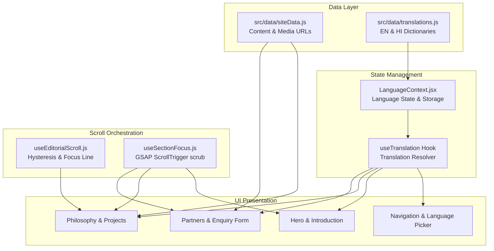

<div align="center">

# Shri Radhika Developers — Digital Flagship & Portfolio

<p align="center">
  <strong>An editorial, high-performance web experience and architectural showcase for Shri Radhika Developers.</strong><br>
  Built with React 19, Tailwind CSS v4, GSAP ScrollTrigger, Leaflet interactive mapping, and Vercel Blob media streaming.
</p>

<p align="center">
  <a href="https://github.com/shriradhikadevelopers-create/Real-Estate"></a>
  <a href="https://react.dev/"></a>
  <a href="https://vite.dev/"></a>
  <a href="https://tailwindcss.com/"></a>
  <a href="https://greensock.com/gsap/"></a>
  <a href="https://leafletjs.com/"></a>
  
</p>

<p align="center">
  <a href="#overview">Overview</a> •
  <a href="#key-features">Features</a> •
  <a href="#tech-stack">Tech Stack</a> •
  <a href="#architecture--data-flow">Architecture</a> •
  <a href="#project-structure">Structure</a> •
  <a href="#installation--setup">Installation</a> •
  <a href="#environment-variables">Environment</a> •
  <a href="#deployment">Deployment</a>
</p>

---

</div>

## Overview

**Shri Radhika Developers** is a bespoke, editorial digital presence crafted for a premier real estate investment and land development company. Departing intentionally from loud, generic property aggregation portals overloaded with clutter and filters, this platform operates as a **curated digital flagship and investor presentation**.

The website tells the story of the developer's multi-decade vision: identifying prime land, developing sustainable community infrastructure, and creating enduring economic and generational value.

```
       ┌────────────────────────────────────────────────────────┐
       │            SHRI RADHIKA DEVELOPERS FLAGSHIP            │
       │                                                        │
       │   [Brand Narrative] ──> [Strategic Pillars] ──>        │
       │   [Curated Projects] ──> [Interactive Media] ──>       │
       │   [Bilingual EN/HI] ──> [Zero-Friction Inquiries]      │
       └────────────────────────────────────────────────────────┘
```

### Target Audience
* **High-Intent Property Buyers**: Exploring layout-approved residential colonies, plotted developments, and gated communities.
* **Private & Institutional Investors**: Evaluating regional land potential, development roadmaps, and capital security.
* **Strategic Development Partners**: Looking to collaborate on large-scale urban and commercial initiatives.
* **Community Stakeholders**: Verifying development legitimacy, municipal approvals, and track records.

### Business Purpose & Value Proposition
* **Brand Authority & Trust**: Replaces templated designs with an architectural aesthetic matching high-value physical real estate.
* **Direct Lead Generation**: Connects prospects directly to project sales desks via an integrated zero-latency form and click-to-call interfaces.
* **Showcase Flagship Developments**: Features comprehensive intelligence on developments such as **Raghavpuram** (Deoband), including layout metrics, interactive galleries, high-definition project films, and geospatial mapping.
* **Bilingual Inclusivity**: Provides parity across English and Hindi (`देवनागरी`), honoring both regional buyers and institutional investors.

---

## Key Features

### User-Facing Experience

* **Cinematic Hero Experience**:
  * Multi-layer entrance sequence orchestrated with GSAP timeline choreography.
  * Foreground botanical foliage framing with subtle cursor-driven depth and parallax.
  * Architectural typography reveals with clean vertical line masks.

* **Bilingual Translation Engine (English & Hindi)**:
  * Complete site-wide internationalization covering navigation, editorial descriptions, project tabs, partner bios, and inquiry forms.
  * `LanguageContext` integration with `localStorage` persistence and automatic `<html lang="">` synchronization.
  * Tailored Devanagari typography using `Noto Sans Devanagari` paired with `Cormorant Garamond` and `Inter`.

* **Interactive Phase Comparative Analysis (Introduction)**:
  * Interactive stage switcher comparing **Planning** vs. **Developed** states.
  * Real-time analytical radar indicators quantifying *Value*, *Potential*, and *Opportunity* versus *Value Created*, *Development Scale*, and *Market Presence*.

* **Four-Pillar Philosophy Deep Dive**:
  * Bespoke animated coordinate graphics representing the 4 core developer pillars:
    1. **Location**: Cartographic contours, directional vectors, and architectural blueprint assets.
    2. **Vision**: Perspective lenses and panoramic horizon lines.
    3. **Development**: Technical floor plans and construction crane vector elevations.
    4. **Value**: Classical architectural column structures and growth arcs.

* **Interactive Project Suite (Featuring Raghavpuram)**:
  * **Multi-Tab Exploration Matrix**:
    * **Overview**: Project statistics (plot count, road dimensions, regulatory approvals, infrastructure highlights).
    * **Gallery Rail**: High-resolution image reel with thumbnail navigation, count indicators, and mobile touch swipe gestures (`touchstart`/`touchend`).
    * **Project Film**: Custom-engineered video player streaming high-definition MP4 footage hosted on **Vercel Blob Storage** with playback rate controls (0.5x–2x), custom scrubber, buffer track, fullscreen mode, and Picture-in-Picture (PiP).
    * **Geospatial Location Map**: Interactive **Leaflet** map instance featuring custom dark-toned OpenStreetMap tiles and strict wheel-scroll protection (`scrollWheelZoom: false`) to safeguard page-level scrolling.

* **Strategic Partners Carousel**:
  * Interactive partner cards highlighting investment strategists, architectural planning leads, and execution directors.
  * Smooth GSAP transitions, touch swiping, and automated rotation with pause-on-hover/drag.

* **Frictionless Lead Capture (Enquiry System)**:
  * Deep-linked project pre-selection: clicking "Enquire Now" on Raghavpuram auto-populates the inquiry context.
  * Client-side validation for name, phone, and email formatting.
  * Serverless delivery powered by **Web3Forms**.
  * Invisible honeypot trap (`botcheck`) preventing spam bot abuse without user friction.

### Architectural & Performance Features

* **Advanced Scroll Physics & Section Focus (`useSectionFocus`)**:
  * Golden Invariant scroll coordination: sections recede subtly to 94% opacity and -15px vertical offset rather than jarringly vanishing.
  * Atmospheric light-to-dark cross-dissolves across boundary sections (`#F4F1EB` Ivory to `#171716` Dark Charcoal).
* **Scroll Index Hysteresis (`useEditorialScroll`)**:
  * Custom layout-effect hook calculating focal dominance and visible height ratios to ensure active states do not oscillate erratically during rapid flick-scrolling.
* **Full Reduced-Motion Support**:
  * Complete graceful fallback for users with vestibular sensitivities (`prefers-reduced-motion: reduce`), bypassing scrub animations and presenting clean static layouts.

---

## Tech Stack

| Domain | Technology | Version | Purpose |
| :--- | :--- | :--- | :--- |
| **Frontend Framework** | [React](https://react.dev/) | `^19.2.8` | Core UI library (`StrictMode`, Context API, Hooks) |
| **Build Tool & Bundler** | [Vite](https://vite.dev/) | `^8.2.2` | Lightning-fast HMR and optimized Rolldown production builds |
| **Styling & Design System** | [Tailwind CSS](https://tailwindcss.com/) | `^4.3.3` | Modern engine with `@tailwindcss/vite` and CSS `@theme` tokens |
| **Motion & Animation** | [GSAP](https://greensock.com/) + [@gsap/react](https://www.npmjs.com/package/@gsap/react) | `^3.15.0` | 60fps hardware-accelerated timelines, `ScrollTrigger`, and `CustomEase` |
| **Geospatial Mapping** | [Leaflet](https://leafletjs.com/) | `^1.9.4` | Interactive vector & tile map rendering with custom dark styling |
| **Media Hosting & Streaming** | [Vercel Blob](https://vercel.com/docs/storage/vercel-blob) | Cloud CDN | High-bitrate MP4 project film streaming via global edge CDN |
| **Form Backend & Inquiries** | [Web3Forms](https://web3forms.com/) | REST API | Zero-backend serverless form processing with spam protection |
| **Typography** | Google Fonts | Web CDN | *Cormorant Garamond* (Serif), *Inter* (Sans), *Noto Sans Devanagari* |
| **Automated Verification** | Headless Chrome Automation | Node.js | Multi-viewport end-to-end scroll & interaction test suites |

---

## Project Structure

```text
Real-Estate/
├── .env.local                    # Local environment secrets (Web3Forms API key)
├── .gitattributes                # Git attributes and LFS configuration
├── .gitignore                    # Git ignore rules for node_modules, dist, etc.
├── index.html                    # Root HTML document, meta viewport & Google Fonts
├── package.json                  # Project manifest, scripts, and dependencies
├── package-lock.json             # Pinned dependency tree
├── vite.config.js                # Vite configuration with React & Tailwind plugins
├── Workflow.md                   # Complete architectural specification & design rules
│
├── scripts/                      # Automated browser verification test suites
│   ├── verify-hero-scroll.mjs    # Hero entry/exit scroll physics verification
│   ├── verify-phase1.mjs         # Phase 1 desktop & mobile viewport test runner
│   ├── verify-phase2.mjs         # Phase 2 section-focus and interactive verification
│   └── test-output/              # Output directory for test snapshot captures
│
└── src/                          # Application source code
    ├── main.jsx                  # Entry point mounting React DOM & LanguageProvider
    ├── App.jsx                   # Master layout, scroll progress bar, and section focus
    ├── index.css                 # Tailwind v4 import, theme tokens, and typography
    │
    ├── assets/                   # Static imagery, foliar elements, and media
    │   ├── back.png              # Architectural background hero layer
    │   ├── intro-image-1.png     # Planning stage land survey graphic
    │   ├── intro-image-2.png     # Developed stage architectural structure graphic
    │   ├── logo-icon.png         # Brand monogram
    │   ├── images/               # Subdivided vector graphic layers for philosophy
    │   │   ├── development/      # Blueprints, construction crane SVGs
    │   │   ├── location/         # Contours, compass, directional vectors
    │   │   ├── value/            # Classical architectural pillar graphics
    │   │   └── vision/           # Horizon lines, telescope, and lens graphics
    │   └── project1/             # Raghavpuram project photography & gallery assets
    │       ├── overview.jpg      # Master project overview shot
    │       └── Gallery/          # Paved roads, entry gates, infrastructure shots
    │
    ├── components/               # Reusable UI component modules
    │   ├── layout/
    │   │   ├── Navigation.jsx    # Sticky navigation, language switcher, mobile drawer
    │   │   └── Footer.jsx        # Company imprint, quick links, back-to-top button
    │   ├── map/
    │   │   └── ProjectLocationMap.jsx # Dark-filtered Leaflet map with Deoband coordinates
    │   ├── video/
    │   │   └── ProjectVideoPlayer.jsx # Custom video player with speed, scrub, PiP controls
    │   └── philosophyGraphics/   # Specialized graphic stages for Philosophy section
    │
    ├── context/
    │   └── LanguageContext.jsx   # React Context managing 'en' / 'hi' state & persistence
    │
    ├── data/
    │   ├── siteData.js           # Single source of truth for company facts, projects, stats
    │   └── translations.js       # Complete bilingual translation dictionaries (EN & HI)
    │
    ├── hooks/
    │   ├── useEditorialScroll.js # Hysteresis-free section and project index tracking
    │   ├── useLanguage.js        # Consumer hook for LanguageContext
    │   ├── useSectionFocus.js    # Master GSAP focus handoff orchestrator
    │   └── useTranslation.js     # Translation lookups with key fallback handling
    │
    └── sections/                 # Main editorial page sections
        ├── Hero.jsx              # Parallax entrance, typography, scroll prompt
        ├── Introduction.jsx      # Brand narrative & interactive stage comparison
        ├── Philosophy.jsx        # 4-stage architectural approach deep-dive
        ├── Projects.jsx          # Tabbed project portfolio (Overview, Gallery, Film, Map)
        ├── Partners.jsx          # Strategic partners carousel
        ├── PortfolioImpact.jsx   # Metrics, years in business, acres developed
        ├── Vision.jsx            # Architectural vision and long-term values
        ├── ClosingCTA.jsx        # High-impact transitional closing banner
        └── Enquiry.jsx           # Validated lead generation form with honeypot
```

---

## Visual Showcase & Screenshots

The application features a cohesive editorial design system built on warm ivory tones (`#F4F1EB`), deep carbon charcoal (`#171716`), and muted architectural accents.

| Section | Viewport | Visual Highlights |
| :--- | :--- | :--- |
| **Hero Entrance** | Desktop & Mobile | Parallax depth layers, masked typography entrance, scroll prompt indicator |
| **Introduction** | Responsive | Interactive stage toggle ("Planning" vs "Developed") with dynamic metric scales |
| **Philosophy Pillars** | Desktop & Mobile | Custom SVG coordinate motions showcasing Location, Vision, Development, Value |
| **Project Suite** | Desktop | Tabbed interface toggling Overview specs, Gallery reel, custom Video Player, and Leaflet Map |
| **Partners Carousel** | Desktop & Mobile | Smooth profile transitions, auto-cycling with hover pause, touch swipe gestures |
| **Enquiry & Contact** | Responsive | Project auto-attachment, real-time input validation, honeypot protection, status banners |

> *Tip: Run the automated verification test suites (`node scripts/verify-phase2.mjs`) to generate high-resolution snapshot captures of all desktop and mobile states directly inside `scripts/test-output/`.*

---

## Installation & Setup

### Prerequisites
* **Node.js**: `v18.0.0` or higher (Node `v20+` recommended)
* **npm**: `v9.0.0` or higher (or `pnpm` / `yarn`)
* **Git**: Installed on your development machine

### 1. Clone the Repository
```bash
git clone https://github.com/shriradhikadevelopers-create/Real-Estate.git
cd Real-Estate
```

### 2. Install Dependencies
```bash
npm install
```

### 3. Configure Environment Variables
Create a `.env.local` file in the root directory:
```bash
cp .env.example .env.local
```
*(Or create `.env.local` manually and add your Web3Forms access key as detailed in [Environment Variables](#environment-variables)).*

### 4. Start the Development Server
```bash
npm run dev
```
Open your browser and navigate to `http://localhost:5173`.

### 5. Build for Production
```bash
npm run build
```
The compiled, tree-shaken, and minified production artifacts will be generated in the `dist/` directory.

### 6. Preview Production Build
```bash
npm run preview
```

### 7. Run Verification Test Suites
The project includes headless Chrome browser automation scripts that capture screenshots and assert scroll and interaction invariants:
```bash
# Verify Phase 1 (Hero scroll physics and initial section handoffs)
node scripts/verify-phase1.mjs

# Verify Phase 2 (Full-page section focus, tab switching, and form validation)
node scripts/verify-phase2.mjs
```

---

## Environment Variables

All client-side environment variables in Vite must be prefixed with `VITE_` to be safely exposed to the client bundle.

| Variable Name | Required | Default / Example Value | Description |
| :--- | :---: | :--- | :--- |
| `VITE_WEB3FORMS_ACCESS_KEY` | **Yes** | `2a24f875-c2d1-4dde-b86c-b1bd3fbfa585` | Public API access key for Web3Forms serverless submission endpoint |

### Setting up Web3Forms
1. Visit [Web3Forms](https://web3forms.com/).
2. Enter the email address where customer inquiries should be delivered.
3. Copy the generated Access Key into your `.env.local`:
   ```env
   VITE_WEB3FORMS_ACCESS_KEY="your-access-key-here"
   ```
4. If this key is missing or set to the placeholder string, the enquiry form will display a clear configuration advisory rather than failing silently.

---

## Architecture & Data Flow

### Unidirectional Data Flow
Content and translation dictionaries are strictly separated from presentation logic:



### Centralized Data System
* **`src/data/siteData.js`**:
  Maintains all commercial information, project specifications (plot counts, road widths, amenities), partner details, and media links. Replacing placeholder projects or adding new developments requires zero JSX modifications.
* **`src/data/translations.js`**:
  Maintains bilingual parallel keypaths across English and Hindi. Fallbacks are automatically resolved to ensure that missing translation keys never crash the layout.

### Scroll Coordination Architecture
* **`useSectionFocus`**:
  Controls section-level wrapper elements (`.section-focus-wrapper`). Driven purely by ScrollTrigger scrub to remain 100% interruptible, reversible, and responsive to scroll velocity.
* **Focus Handoff Invariant**:
  When scrolling from Section A to Section B, Section A gracefully recedes to `0.94` opacity and `0.985` scale, preventing abrupt pop-in or blank visual voids.

---

## Performance & Optimizations

* **Vite 8 & Rolldown Bundling**:
  Utilizes Vite 8 with ES module imports and efficient chunking, producing a lightweight initial JavaScript bundle with sub-second page loads.
* **Tailwind CSS v4 Native Engine**:
  Configured with `@tailwindcss/vite` without legacy PostCSS overhead, compiling utility classes on the fly with zero unused CSS in production.
* **Zero Layout Shift (CLS = 0)**:
  All media containers, video shells, and Leaflet map frames maintain predefined aspect ratios and layout boundaries to eliminate content shifts during image loading.
* **Hardware-Accelerated GSAP Animations**:
  All scroll and hover effects operate strictly on composite properties (`transform`, `opacity`, `translate3d`, `filter`), guaranteeing steady 60fps execution even on lower-power mobile devices.
* **Edge CDN Video Offloading**:
  Heavy 1080p promotional video assets are hosted on **Vercel Blob Storage** (`public.blob.vercel-storage.com`), enabling byte-range seeking, instant playback buffering, and zero bandwidth strain on the primary host.
* **Non-Blocking Leaflet Map Loading**:
  The Leaflet geospatial engine is only instantiated when mounted, with custom tile layers loaded asynchronously and wheel scrolling disabled to ensure touch and trackpad momentum remains uninterrupted.

---

## Deployment Guide (Vercel)

The repository is pre-configured for instant zero-configuration deployment on **Vercel**.

### Deploying via Vercel Web Dashboard

1. Push your latest code to GitHub:
   ```bash
   git push origin main
   ```
2. Navigate to the [Vercel Dashboard](https://vercel.com/dashboard) and click **"Add New Project"**.
3. Import the `shriradhikadevelopers-create/Real-Estate` repository.
4. Verify the Framework Preset is detected as **Vite**.
5. Set Build & Output Settings:
   * **Build Command**: `npm run build`
   * **Output Directory**: `dist`
   * **Install Command**: `npm install`
6. In **Environment Variables**, add:
   * **Key**: `VITE_WEB3FORMS_ACCESS_KEY`
   * **Value**: *Your Web3Forms access key*
7. Click **Deploy**.

### Deploying via Vercel CLI
```bash
# Install Vercel CLI globally
npm install -g vercel

# Login to your Vercel account
vercel login

# Link and deploy
vercel

# Deploy to production
vercel --prod
```

---

## Security Considerations

* **Client-Side Secrets Isolation**:
  Only environment variables prefixed with `VITE_` are bundled. No database connection strings, server secrets, or private keys exist within the repository.
* **Serverless Form Routing**:
  Form handling is delegated to Web3Forms over encrypted HTTPS REST endpoints. No server endpoints or exposed mail daemons exist to be exploited.
* **Bot & Spam Mitigation**:
  The inquiry form incorporates a hidden honeypot field (`botcheck`). If automated scrapers or spam bots populate this input, the submission is silently dropped before transmission.
* **Input Sanitization & Validation**:
  All user inputs (name, email, phone, message) undergo strict client-side regex checking before transmission, mitigating malformed payloads.
* **Safe External Links**:
  All outgoing links (e.g., OpenStreetMap attributions, social links) enforce `rel="noopener noreferrer"` attributes to prevent tab-napping and referrer leaks.

---

## Future Roadmap

- [ ] **Interactive Master Plan Navigator**: Interactive vector SVG map of Raghavpuram allowing prospective buyers to click individual plots and view square footage, dimension ratios, and real-time booking availability.
- [ ] **360° Virtual Property Tours**: WebGL/Three.js-powered panoramic exploration of roads, green spaces, and boundary infrastructure.
- [ ] **Brochure PDF Generator**: Dynamic generation of project spec sheets and site plans directly in the browser via edge functions.
- [ ] **Instant WhatsApp Lead Dispatch**: One-click WhatsApp Business messaging pre-filled with selected project ID and inquiry type.
- [ ] **Investor Due Diligence Portal**: Downloadable layout approvals, regulatory clearance certificates, and land title documentation for institutional investors.

---

## Contributing

Contributions, feedback, and architectural suggestions are warmly welcome!

1. **Fork the Repository**
2. **Create a Feature Branch**:
   ```bash
   git checkout -b feature/editorial-enhancement
   ```
3. **Commit Your Changes**:
   ```bash
   git commit -m "feat: enhance project gallery transition physics"
   ```
4. **Run Verification Tests**:
   ```bash
   npm run build
   node scripts/verify-phase2.mjs
   ```
5. **Push to the Branch**:
   ```bash
   git push origin feature/editorial-enhancement
   ```
6. **Open a Pull Request** with a detailed summary of your changes.

---

## License

This project is licensed under the [MIT License](LICENSE) — see the LICENSE file for details.
*Note: Brand trademarks, project photography, and proprietary architectural renderings of Shri Radhika Developers are all rights reserved by their respective copyright owners.*

---

## Author & Acknowledgements

* **Lead Developer & Engineering**: **SpySparsh** ([@SpySparsh](https://github.com/SpySparsh) • `spyspring30@gmail.com`)
* **Client / Organization**: **Shri Radhika Developers**
* **Inspiration & Assets**:
  * [GreenSock (GSAP)](https://greensock.com/) for animation primitives
  * [Tailwind Labs](https://tailwindcss.com/) for Tailwind CSS v4
  * [OpenStreetMap](https://www.openstreetmap.org/) contributors for cartographic data
  * [Unsplash](https://unsplash.com/) for architectural photography placeholders

<div align="center">
  <sub>Crafted with precision for Shri Radhika Developers. Built for longevity, scale, and performance.</sub>
</div>
